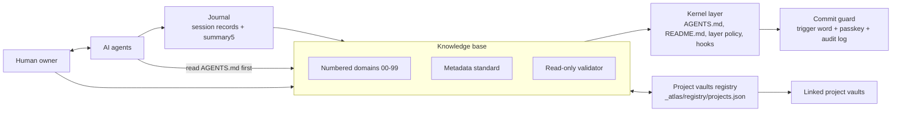

# FRACT starter

**FRACT** (Foundational Recursive Applied and Cognitive Tooling) is a knowledge base that you and your AI agents run together. It is for anyone who runs many projects with AI agents and wants those agents to share one structured, checkable memory instead of starting from zero in every chat. Notes live in plain Markdown that opens as an Obsidian vault; every note carries strict metadata; a read-only validator checks the whole vault; the rule files form a protected kernel that changes only through a passkey-gated commit; projects get their own linked vaults; and every session closes with a short, standard record. This repository is the blank edition: the structure, rules and tools, with no private content.

## Architecture



## Features

- **Core knowledge base.** Eleven numbered domains, from `00-system` to `99-archive`, each with an index note; one [metadata standard](00-system/Metadata%20Standard.md) for every note; a standard-library Python validator that checks metadata, links, duplicates and residue ([Validation Policy](00-system/Validation%20Policy.md)).
- **Layer guard.** The files that define how agents behave form a kernel. A Git pre-commit hook refuses any commit that touches them unless it carries the trigger word and the owner's passkey, and logs every decision ([Layer Guard](00-system/Layer%20Guard.md)).
- **Agent skills pack.** Fourteen portable skills: discipline, evidence labels, verification, hand-off reports, session open and close, Socratic learning, and team workflows for building, reviewing, bug hunting, research, testing and vault audits. See the [skills README](.agents/skills/README.md).
- **Projects and journal.** One command creates a linked project vault with its own guard and registers it ([Project Vaults](00-system/Project%20Vaults.md)). Every session ends with a record and a five-part `summary5` close ([Journal Index](80-journal/Journal%20Index.md)).

## Quickstart

Requirements: Git, Python 3.11 or newer, Node 18 or newer (for the commit guard), and Obsidian if you want the graph view.

1. Clone this repository and open its folder as a vault in Obsidian.
2. Set your passkey and enable the commit guard:
   ```bash
   python -B code/setup/init_vault.py
   ```
3. Check the vault:
   ```bash
   python -B code/validation/validate.py
   ```
4. Point your AI agent at [AGENTS.md](AGENTS.md) and ask it to follow the loading order there.

## Folder map

| Path | What lives there |
| --- | --- |
| `AGENTS.md` | The loader every agent reads first |
| `00-system/` | Rules, standards, templates: start at [System Hub](00-system/System%20Hub.md) |
| `10-core/` to `70-human/` | Your knowledge, by domain |
| `80-journal/` | Session records and the `summary5` guide |
| `90-assets/` | Images, canvases and other files notes link to |
| `99-archive/` | Retired notes, kept readable |
| `.agents/skills/` | The agent skills pack |
| `_atlas/` | Layer policy, project registry, guard audit log |
| `code/` | Validator, commit guard, setup scripts |

## Origin

FRACT starter is the blank edition of the system its author uses every day to run projects and teams of AI agents. Author: Matei Chiriacescu. Licensed under the MIT License; see `LICENSE`.
